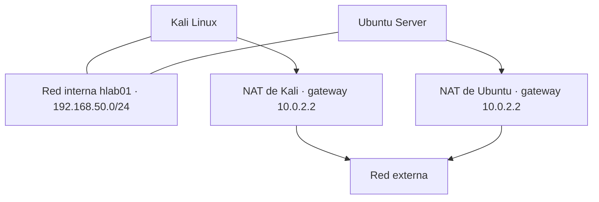

# HomeLab 01 — Redes y administración Linux

Construí un laboratorio con Kali Linux y Ubuntu Server en VirtualBox para comprender cómo se comunican dos sistemas y cómo administrar uno desde el otro. Trabajé desde el direccionamiento y la resolución ARP hasta SSH, registros, permisos y un firewall de host, relacionando cada configuración con su funcionamiento y sus evidencias.

**Autor:** [Máximo Rodríguez](https://github.com/msrmaximo-sys).

## El laboratorio

Utilicé una red interna `hlab01` para comunicar las VM y un adaptador NAT independiente en cada una para la salida externa. Mi objetivo fue construir una base práctica de redes y administración Linux para continuar mi formación en Sistemas y ciberseguridad defensiva.

| Equipo | Interfaz interna | IPv4 interna | Interfaz NAT | IPv4 NAT | Recursos documentados |
| --- | --- | --- | --- | --- | --- |
| Kali Linux | `eth1` | `192.168.50.20/24` | `eth0` | `10.0.2.50/24` | 4096 MB RAM, 2 vCPU |
| Ubuntu Server | `enp0s8` | `192.168.50.10/24` | `enp0s3` | `10.0.2.15/24` | 3072 MB RAM, 2 vCPU |



Los dos adaptadores NAT corresponden a instancias independientes: compartir la dirección de gateway `10.0.2.2` no significa compartir una LAN. La comunicación entre las VM del laboratorio utiliza la red interna. No configuré las VM como routers.

## Resultados

| Prueba | Resultado | Evidencia |
| --- | --- | --- |
| Direcciones y rutas | IP internas persistentes; Kali selecciona `eth1` para llegar a Ubuntu | Informe, secciones 3–5 |
| ARP e ICMP local | Resolución de la MAC de Ubuntu y cuatro pares Echo Request/Reply | PCAP 01, tramas 1–10 |
| Destino externo | MAC del gateway como destino Ethernet; `8.8.8.8` como destino IPv4 | PCAP 02 |
| Vecino sin respuesta | Tres solicitudes ARP por `192.168.50.99`, sin respuesta en la captura | PCAP 03 |
| SSH | Acceso con contraseña como `maxi`, verificación de huella del host y revisión de registros | Informe, secciones 8–9 |
| TCP de SSH | Establecimiento en tramas 1–3 y cierre ordenado en 775–778 | PCAP 04 |
| Permisos | Escritura rechazada sin `w` y recuperada al restaurar `u+w`; archivo final con modo 600 | Informe, sección 10 |
| UFW | Regla de entrada para SSH desde Kali y prueba de una conexión nueva | Informe, sección 11 |
| Persistencia | Comunicación, SSH y reglas conservados tras apagar y arrancar las VM | Confirmación de cierre documentada; sin captura de cada consulta posterior |

La regla específica aplicada en Ubuntu fue:

```bash
sudo ufw allow in on enp0s8 proto tcp from 192.168.50.20 to 192.168.50.10 port 22
```

La acompañé con las políticas `deny incoming` y `allow outgoing`. El tráfico es entrante desde la perspectiva de Ubuntu. Una sesión ya establecida no basta para validar nuevas conexiones; por eso comprobé otra sesión desde Kali.

## Documentación

| Documento | Lectura en GitHub | PDF | Editable |
| --- | --- | --- | --- |
| Guía e informe | [informe.md](docs/informe.md) | [PDF](docs/01_HomeLab01_Guia_Informe.pdf) | [DOCX](docs/01_HomeLab01_Guia_Informe.docx) |
| Comandos e interpretación | [comandos.md](docs/comandos.md) | [PDF](docs/02_HomeLab01_Comandos.pdf) | [DOCX](docs/02_HomeLab01_Comandos.docx) |
| Fundamentos y glosario | [fundamentos.md](docs/fundamentos.md) | [PDF](docs/03_HomeLab01_Fundamentos.pdf) | [DOCX](docs/03_HomeLab01_Fundamentos.docx) |

Las versiones DOCX y PDF son los documentos existentes de la edición del 14 de noviembre de 2026. Markdown adapta los DOCX para lectura en GitHub, conservando contenido, tablas y las 17 figuras del informe. El [registro de versión](docs/VERSION.md) identifica las fuentes y sus huellas; no se reescribieron los documentos originales durante esta preparación.

## Evidencias conservadas

| Archivo | Tramas | Uso |
| --- | ---: | --- |
| [01-arp-icmp-red-interna.pcapng](evidencias/01-arp-icmp-red-interna.pcapng) | 15 | ARP e ICMP entre Kali y Ubuntu |
| [02-icmp-destino-externo.pcapng](evidencias/02-icmp-destino-externo.pcapng) | 17 | Gateway NAT e ICMP con `8.8.8.8` |
| [03-arp-sin-respuesta.pcapng](evidencias/03-arp-sin-respuesta.pcapng) | 3 | Resolución ARP sin respuesta por `.99` |
| [04-ssh-conexion-y-cierre.pcapng](evidencias/04-ssh-conexion-y-cierre.pcapng) | 778 | Conversación TCP `33648 → 22` |
| [Figuras del informe](evidencias/capturas/) | 17 imágenes | Topología y capturas extraídas del DOCX |
| [SHA256SUMS](evidencias/SHA256SUMS) | 4 huellas | Integridad de los PCAPNG |

El [índice de evidencias](evidencias/README.md) reúne filtros, referencias y límites. Los PCAPNG corresponden al tráfico de esta práctica; se incluyen para que el análisis pueda revisarse. La topología es una reconstrucción documental, no una captura del sistema.

## Cómo reproducir la revisión

1. Descargar o clonar este repositorio.
2. Comprobar las huellas desde la carpeta `evidencias` con `sha256sum -c SHA256SUMS` en Linux.
3. Abrir los PCAPNG en Wireshark y seguir el índice de evidencias y los números de trama del informe.
4. Para repetir las pruebas en VM propias, seguir la guía desde la preparación de adaptadores. Adaptar interfaces y perfiles a esa instalación.

Los comandos del informe son pasos de estudio contextualizados, no un script para ejecutar de principio a fin sobre cualquier equipo.

## Qué aprendí

- Relacionar la ruta elegida con la interfaz, el siguiente salto y la MAC de destino.
- Interpretar Ethernet, ARP, IPv4, ICMP y TCP sin confundir encapsulación con transmisiones distintas.
- Distinguir configuración guardada, estado aplicado y funcionamiento comprobado.
- Relacionar SSH con sockets, servicios, cuentas, conexiones y registros de autenticación.
- Interpretar permisos y resolver un rechazo de escritura sin recurrir automáticamente a `sudo`.
- Aplicar una regla UFW y delimitar lo que demuestra una prueba positiva.

## Alcance y límites

No instalé un SIEM ni ejecuté malware. La autenticación SSH fue con contraseña; no configuré claves de usuario. No probé el bloqueo de SSH desde un origen distinto de Kali ni realicé un endurecimiento completo del servidor. UFW también trata conexiones establecidas y otros protocolos mediante reglas previas: esta configuración no significa que todo paquete distinto de SSH quede bloqueado.

Las sesiones SSH de los registros, las capturas de pantalla y el PCAP 04 no son todas la misma conexión. El canal cifrado no permite deducir los comandos ejecutados dentro de la sesión. Mantengo estas distinciones en el informe.

## Fuentes y autoría

El informe y los fundamentos enlazan la documentación de VirtualBox, NetworkManager, Netplan, OpenSSH, systemd, GNU Coreutils y UFW, junto con las RFC de ARP, ICMP y TCP. Esas referencias explican el funcionamiento; las evidencias locales respaldan los resultados de la práctica.

Este proyecto continúa mi recorrido iniciado con [Malware Traffic Analysis — Easy As 123](https://github.com/msrmaximo-sys/malware-traffic-analysis-easy-as-123).

Contacto de autoría de GitHub: `251791361+msrmaximo-sys@users.noreply.github.com` (dirección noreply).
