# HomeLab 01 — Guía e informe del proyecto

Adaptación para lectura en GitHub del [documento original](01_HomeLab01_Guia_Informe.docx). Se conservan sus contenidos, tablas y figuras; la presentación y la paginación son distintas.

[Volver al proyecto](../README.md)

HOMELAB 01

Guía e informe del proyecto

Del direccionamiento al acceso remoto y al firewall

Máximo Rodríguez

Redes · Linux · Administración · Fundamentos de seguridad

Edición de estudio | 14 de noviembre de 2026

Documento 01 de 3

### Cómo uso este documento

Sigo el recorrido práctico, interpreto las evidencias y consulto el documento 02 cuando necesito ampliar un comando. Uso el documento 03 para repasar fundamentos.

### Contenido

1. Propósito, alcance y criterio de evidencia

2. Entorno y topología

3. Inventario inicial y decisiones de ruta

4. Direccionamiento temporal y diagnóstico en Kali

5. Persistencia en Ubuntu con Netplan

6. ARP e ICMP en la red interna

7. Destino remoto y fallo de resolución

8. SSH: programa, servicio, socket e identidad

9. Sesiones, registros y observación de TCP

10. Usuarios, grupos y permisos

11. UFW y comprobación final

12. Dificultades, conclusiones y límites

13. Evidencias, integridad y referencias

## 1. Propósito, alcance y criterio de evidencia

Construí HomeLab 01 para comprender cómo se comunican dos sistemas Linux y cómo administrar uno de ellos desde el otro. Mi objetivo fue relacionar configuraciones, paquetes, procesos, permisos y registros, y explicar por qué una prueba funcionó o falló. Utilicé Kali como cliente y Ubuntu Server como servidor, dentro de VirtualBox sobre Windows.

Completé direccionamiento, persistencia, ARP, ICMP, acceso SSH, observación de TCP, usuarios y permisos, y una regla de firewall de host. No instalé un SIEM ni ejecuté malware. Tampoco configuré autenticación SSH mediante claves de usuario, un servidor DNS propio, VLAN, VPN o un router entre subredes. Esos temas no forman parte de los resultados de este laboratorio.

Resultado: mantuve la comunicación interna, el acceso SSH autorizado y las reglas UFW después de apagar y volver a iniciar las VM. Para documentar el cierre utilicé las salidas guardadas y mi confirmación de funcionamiento; no dispongo de una captura nueva de cada comprobación posterior al arranque.

### Cómo interpreto las fuentes

| Fuente | Qué respalda | Límite |
| --- | --- | --- |
| Mis notas en Homelab 01.docx y HomeLab01.pdf | Procedimientos, explicaciones y capturas del trabajo | Algunas frases eran instrucciones del chat o apuntes incompletos; las revisé antes de incorporarlas. |
| Cuatro archivos PCAPNG recuperados | Paquetes y referencias de trama verificables | No muestran por sí solos todo el estado del sistema ni los comandos dentro de SSH cifrado. |
| Configuración .vbox de cada VM | RAM, procesadores, adaptadores y MAC guardados | Describe la configuración consultada durante la revisión, no todos sus cambios históricos. |
| Confirmaciones de la conversación | Ubuntu 26.04.1 LTS, restauración de permisos y persistencia final | El enlace compartido no pudo recuperarse íntegramente; esta edición no es una transcripción exhaustiva del chat. |
| Documentación de los proyectos | Fundamentos y significado de comandos | Una fuente técnica explica el funcionamiento; no demuestra que yo haya ejecutado una acción. |

En esta edición organicé mi recorrido en primera persona. Cuando incluyo un procedimiento complementario para repetir una prueba, lo identifico expresamente. Las capturas grises con explicaciones del chat se transformaron en tablas editables: las uso como material de estudio, no como evidencia de ejecución.

## 2. Entorno y topología

Elegí Ubuntu Server sin entorno gráfico para practicar administración por terminal. Utilicé Kali como estación cliente y de captura. La selección de Kali no convierte el ejercicio en una prueba ofensiva: en esta práctica lo usé para configuración de red, ping, SSH y Wireshark.

| Recurso | Kali | Ubuntu Server |
| --- | --- | --- |
| Memoria guardada | 4096 MB | 3072 MB |
| Procesadores virtuales | 2 | 2 |
| Sistema | Kali Linux; VERSION="2026.3"<br> | Ubuntu 26.04.1 LTS |
| Disco | Disco virtual de 80 GB observado con lsblk | Disco virtual de 25 GB observado con lsblk |
| Adaptador 1 | NAT, eth0 | NAT, enp0s3 |
| Adaptador 2 | Red interna hlab01, eth1 | Red interna hlab01, enp0s8 |
| Cuenta empleada | kali | maxi |

La memoria y los procesadores corresponden a la configuración final consultada. No son requisitos mínimos universales. El disco de 25 GB es capacidad total, no espacio libre disponible. 

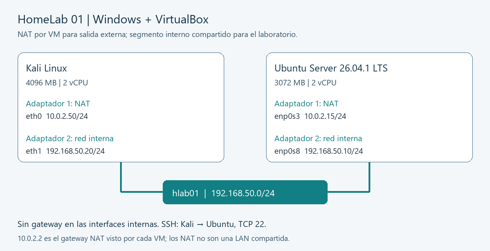

Figura 1. Topología reconstruida a partir de los adaptadores guardados y las direcciones observadas. Los dos adaptadores NAT pertenecen a instancias NAT independientes.

| Equipo / interfaz | IPv4 | MAC relevante | Función |
| --- | --- | --- | --- |
| Kali eth0 | 10.0.2.50/24 | 08:00:27:5a:87:bc | Salida externa por NAT |
| Kali eth1 | 192.168.50.20/24 | 08:00:27:ae:40:32 | Comunicación interna |
| Ubuntu enp0s3 | 10.0.2.15/24 | 08:00:27:8e:5f:ae | Salida externa por NAT |
| Ubuntu enp0s8 | 192.168.50.10/24 | 08:00:27:b6:92:36 | Comunicación interna y recepción SSH |

En cada VM, 10.0.2.2 es el gateway virtual visto por su adaptador NAT. Que ambas VM muestren ese gateway no significa que sus adaptadores NAT compartan una LAN. El enlace común que elegí para el laboratorio es hlab01. No configuré reenvío ni puente entre sus dos interfaces: tener dos adaptadores no convierte automáticamente a Kali o Ubuntu en routers.

### Preparación para repetir el entorno

Con las VM apagadas, mi configuración de referencia es Adaptador 1 conectado a NAT y Adaptador 2 conectado a Red interna, con el nombre exacto hlab01 y cable conectado. Luego identifiqué dentro de Linux qué interfaz corresponde a cada adaptador comparando las MAC. No deduje el modo de VirtualBox solamente por ver una IP privada.

No documenté cada pantalla del instalador ni el nombre exacto de la ISO. La reproducción de esta guía parte de dos VM Linux instaladas, con acceso a sus consolas y a una cuenta con sudo. Las interfaces y los nombres de perfiles deben adaptarse si una instalación nueva utiliza otros valores.

## 3. Inventario inicial y decisiones de ruta

Primero comprobé los discos, las interfaces y las rutas. Estas consultas no cambiaron la configuración.

```bash
# Ubuntu
lsblk -o NAME,SIZE,TYPE,MOUNTPOINTS
ip -br address
ip route
```

```bash
# Kali
ip -br address
ip route
```

Observé /dev/sda de 25 GB en Ubuntu y su partición principal montada en /. Las interfaces NAT tenían IPv4; las internas todavía no tenían la IPv4 del laboratorio. En Kali también aparecía docker0 con 172.17.0.1/16 y estado DOWN. No lo utilicé para comunicar las VM ni inferí por ese estado que todo Docker estuviera detenido.

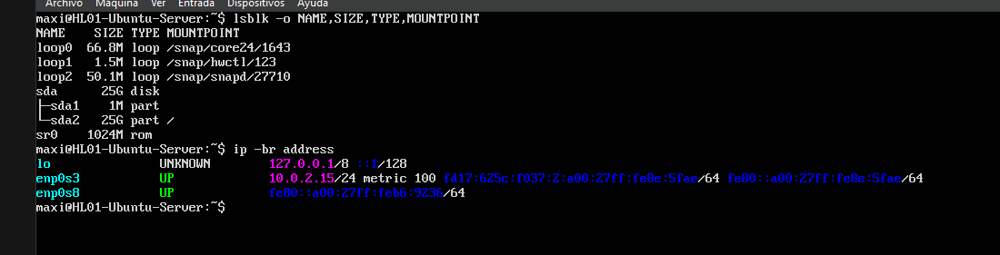

Figura 2. Inventario inicial de Ubuntu. La capacidad de sda y el punto de montaje cumplen funciones diferentes.

La ruta predeterminada de Kali era default via 10.0.2.2 dev eth0. La interpreté como la alternativa para destinos sin una ruta más específica. Para Ubuntu necesitaba una ruta directamente conectada por eth1; no debía enviar ese tráfico al NAT.

```bash
# Kali: consulta de decisión local, no prueba de conectividad
ip route get 192.168.50.10
```

La elección de ruta ocurre antes de resolver la MAC del siguiente salto. Por eso primero identifiqué la interfaz de salida y después comprobé vecinos y paquetes. Una consulta de ruta exitosa no prueba que el destino esté encendido.

## 4. Direccionamiento temporal y diagnóstico en Kali

Para observar el efecto inmediato de una IP, agregué direcciones a la configuración activa del kernel.

```bash
# Ubuntu
sudo ip address add 192.168.50.10/24 dev enp0s8
```

```bash
# Kali
sudo ip address add 192.168.50.20/24 dev eth1
ip route get 192.168.50.10
```

En Kali encontré una discrepancia: la IP había aparecido en una salida, pero la ruta consultada todavía elegía eth0 y el gateway NAT. Antes de agregar una ruta manual, comprobé si la dirección seguía presente y qué administraba esa interfaz.

```bash
ip -4 address show dev eth1
nmcli -f GENERAL,IP4 device show eth1
nmcli -f NAME,TYPE,DEVICE connection show
```

La consulta IPv4 ya no mostraba una dirección en eth1. Identifiqué el perfil Wired connection 2. La conclusión respaldada fue que faltaba la IPv4 activa y que no había quedado guardada en el perfil. La posibilidad de que NetworkManager la hubiera retirado explicaba el síntoma, pero no conservé un evento que confirmara esa causa exacta.

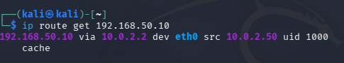

Figura 3. La consulta seleccionaba eth0 y 10.0.2.2 para un destino que debía ser local por eth1.

### Solución persistente

```bash
sudo nmcli connection modify "Wired connection 2" \
  ipv4.method manual \
  ipv4.addresses 192.168.50.20/24 \
  ipv4.gateway "" \
  ipv4.never-default yes \
  connection.autoconnect yes
sudo nmcli connection up "Wired connection 2"
ip route get 192.168.50.10
```

Guardé una IP fija, dejé vacío el gateway y evité que el perfil interno aportara una ruta predeterminada. Luego activé el perfil. La consulta pasó a seleccionar eth1 y 192.168.50.20 como origen. Separé así tres acciones: editar lo guardado, aplicarlo y comprobar el resultado.

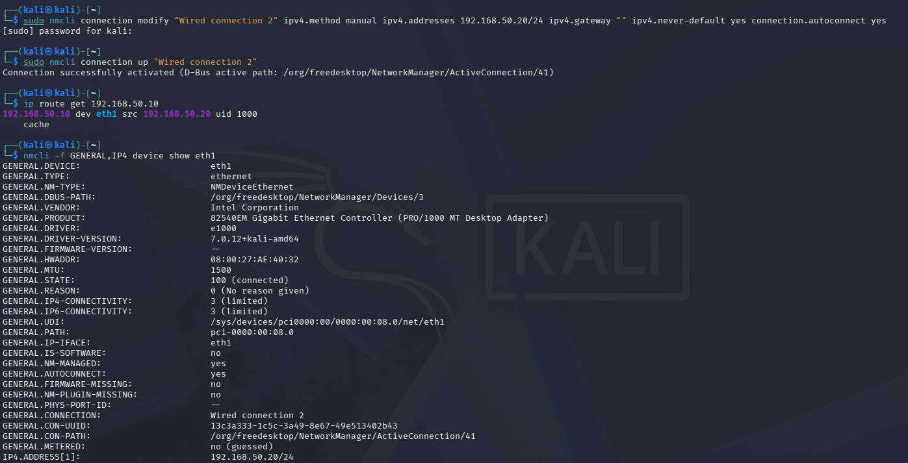

Figura 4. Activación del perfil y selección correcta de la interfaz interna. Los UUID de perfil y otros identificadores no necesitan memorizarse.

Para repetir la guía en una VM nueva, primero identifico el perfil real. Wired connection 2 es el nombre observado en este laboratorio; no es un nombre obligatorio. Si la dirección ya está configurada, no repito ip address add ni creo perfiles duplicados.

## 5. Persistencia en Ubuntu con Netplan

En Ubuntu comprobé que la IPv4 interna estaba activa, pero todavía no figuraba en la configuración guardada de Netplan.

```bash
ip -br address
ls -l /etc/netplan/
sudo netplan get
```

Identifiqué /etc/netplan/00-installer-config.yaml. Conservé la sección NAT existente, que identificaba enp0s3 por su MAC y obtenía configuración por DHCP. Hice un respaldo antes de editar.

```bash
sudo cp -p -n /etc/netplan/00-installer-config.yaml \
  /etc/netplan/00-installer-config.yaml.bak
sudo nano /etc/netplan/00-installer-config.yaml
```

La advertencia asociada a cp -n se refería a la opción de copia, no a un fallo de red. Verifico que el respaldo exista antes de continuar. El archivo .bak no es un YAML procesado como configuración por Netplan.

La estructura documentada, con indentación por espacios, quedó así. Para otra VM conservo su sección NAT real: no copio la MAC de este ejemplo sobre una máquina diferente.

```yaml
network:
  version: 2
  ethernets:
    enp0s3:
      dhcp4: true
      dhcp6: true
      match:
        macaddress: "08:00:27:8e:5f:ae"
      set-name: "enp0s3"
    enp0s8:
      dhcp4: false
      addresses:
        - 192.168.50.10/24
# Ubuntu, desde su consola
sudo netplan generate
sudo netplan get
sudo netplan try
```

```bash
# Kali, mientras la prueba espera confirmación
ping -c 4 192.168.50.10
```

generate valida y genera configuración para el backend; no aplica por sí solo el cambio a la red en ejecución. Con try hice una aplicación temporal y confirmé desde Ubuntu después de comprobar el ping. Si una prueba revierte o falla, verifico el estado efectivo y el archivo guardado antes de reiniciar; no doy por hecho que ambos quedaron idénticos. [R2]

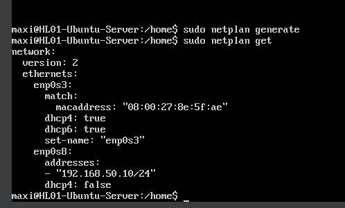

Figura 5. Netplan ya incluye enp0s8 con la IPv4 fija. Consultar lo guardado y consultar el kernel responde preguntas distintas.

Reinicié Ubuntu y volví a comprobar direcciones y comunicación. Al cierre del proyecto también confirmé persistencia después de apagar e iniciar las VM. La prueba fue un arranque real, no solamente guardar el estado de VirtualBox.

## 6. ARP e ICMP en la red interna

Quise observar cómo Kali obtiene la MAC de Ubuntu antes de enviar un ping. En Wireshark inicié captura en eth1 y apliqué el filtro de visualización arp || icmp. El filtro cambia lo visible; no elimina paquetes del archivo.

```bash
# Kali: consulta de la asociación existente
ip neigh show to 192.168.50.10 dev eth1
```

```bash
# Elimino únicamente la entrada del vecino que voy a estudiar
sudo ip neigh del 192.168.50.10 dev eth1
ping -c 4 192.168.50.10
```

Si al repetir la práctica la entrada no existe, su eliminación puede informar ese hecho. No necesito vaciar toda la tabla. Inicio la captura antes de generar el tráfico para no perder la consulta inicial.

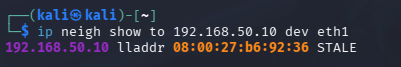

Figura 6. Asociación de vecino de Ubuntu. STALE indica que la alcanzabilidad no se confirmó recientemente; no significa desconectado.

El archivo 01-arp-icmp-red-interna.pcapng conserva 15 tramas en total. El intercambio analizado comprende cuatro tramas ARP y ocho ICMP; hay otras tres tramas fuera de esos protocolos. Por eso no igualo el total del archivo con el total visible bajo el filtro.

| Tramas del archivo 01 | Observación | Interpretación |
| --- | --- | --- |
| 1 | Kali pregunta por 192.168.50.10 mediante broadcast Ethernet | Necesita resolver al vecino local. |
| 2 | Ubuntu responde con 08:00:27:b6:92:36 | Obtengo la asociación IP–MAC necesaria. |
| 3–10 | Cuatro Echo Request y cuatro Echo Reply | Cada solicitud y cada respuesta viajan en una trama distinta. |
| 11–12 | Otro intercambio ARP, iniciado por Ubuntu | La resolución de vecinos puede aparecer también desde el otro extremo. |

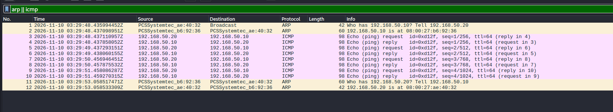

Figura 7. Vista del intercambio ARP/ICMP. Corregí la referencia de la respuesta ARP a la trama 2; 42 no era su número de trama.

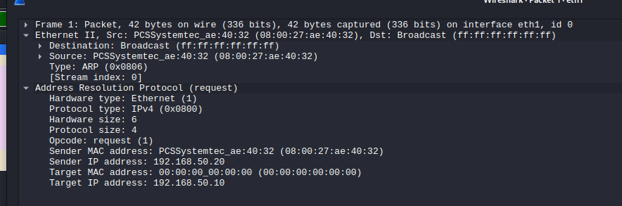

Figura 8. Solicitud ARP: destino Ethernet broadcast y Target IP address 192.168.50.10. ARP contiene direcciones IP como campos propios.

La captura de un Echo Reply muestra Ethernet, IPv4 e ICMP dentro de una sola transmisión. No son tres envíos. Identifier y Sequence Number permiten relacionar solicitud y respuesta; compartirlos no convierte dos tramas en una. En Wireshark también aparecen representaciones BE y LE: para esta comparación mantengo una misma representación, sin contar cada representación como otro mensaje.

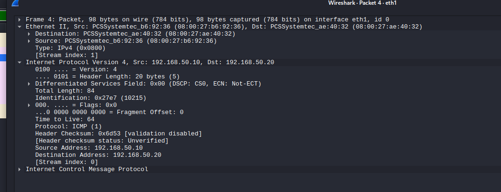

Figura 9. Echo Reply de Ubuntu: Ethernet contiene IPv4 y el paquete IPv4 contiene ICMP.

## 7. Destino remoto y fallo de resolución

### Salida hacia 8.8.8.8

En Kali cambié la captura a eth0, consulté la ruta y ejecuté el ping externo.

```bash
ip route get 8.8.8.8
ping -c 4 8.8.8.8
ip neigh show to 10.0.2.2 dev eth0
```

En 02-icmp-destino-externo.pcapng confirmé ARP por 10.0.2.2 y cuatro pares ICMP con 8.8.8.8. La MAC de destino de las tramas salientes coincidía con la del gateway, mientras la IP destino del paquete seguía siendo 8.8.8.8. No busqué la MAC del servidor remoto mediante ARP.

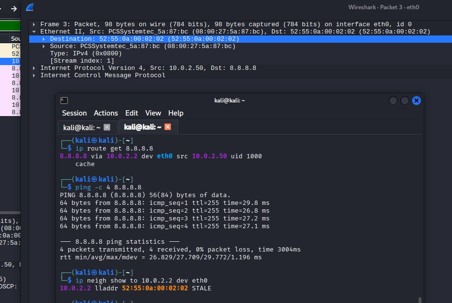

Figura 10. Comparación entre la MAC del gateway en la tabla de vecinos y el destino Ethernet del ping externo.

### Una IPv4 interna sin respuesta

El archivo 03-arp-sin-respuesta.pcapng conserva tres solicitudes ARP por 192.168.50.99, sin respuestas ni Echo Request transmitidos en ese archivo. La captura de terminal muestra el error de destino inalcanzable y el vecino FAILED.

```bash
# Kali; destino utilizado en la prueba documentada
ping -c 3 -W 1 192.168.50.99
ip neigh show to 192.168.50.99 dev eth1
```

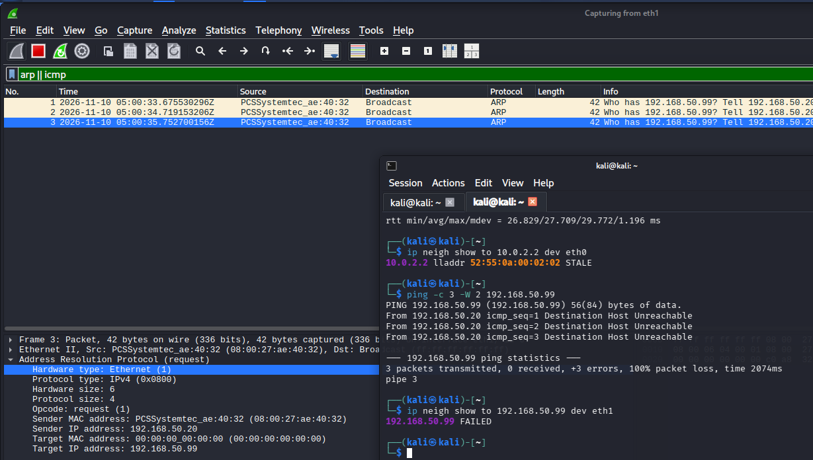

Figura 11. Consulta ARP sin respuesta y Destination Host Unreachable. La evidencia identifica el paso que falló.

Concluí que no se resolvió la MAC del vecino durante esa prueba. No concluí que el destino hubiera recibido y rechazado el ping. Un equipo apagado, otra IP o un enlace incorrecto pueden producir resultados compatibles; la captura no permite elegir por sí sola una causa única.

## 8. SSH: programa, servicio, socket e identidad

Después de la conectividad básica, preparé Ubuntu para recibir sesiones remotas. Verifiqué el sistema y actualicé los índices de paquetes antes de instalar OpenSSH Server.

```bash
# Ubuntu
cat /etc/os-release
sudo apt update
sudo apt install openssh-server
systemctl status ssh.service ssh.socket --no-pager
sudo ss -lntp
```

apt update actualiza índices; no equivale a actualizar todos los paquetes instalados. Encontré ssh.service inicialmente inactive (dead) y disabled, mientras ssh.socket estaba enabled y active (listening). El socket podía activar el servicio al llegar una conexión. No traté disabled como sinónimo de imposible de iniciar. [R3]

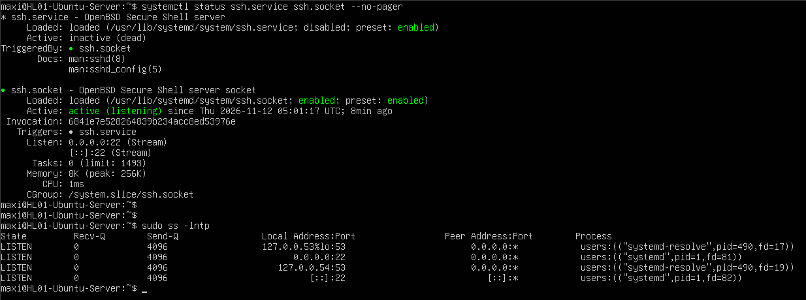

Figura 12. Estado previo a la sesión y escucha en TCP 22. systemd aparece asociado al socket.

En ss observé 0.0.0.0:22 y [::]:22: escucha en todas las direcciones locales de cada familia, no conexiones desde todas las IP de Internet. El alcance real depende de los enlaces, rutas, NAT y firewall.

```bash
# Kali
ssh maxi@192.168.50.10
```

```bash
# Ubuntu, en su consola local para contrastar la identidad
sudo ssh-keygen -lf /etc/ssh/ssh_host_ed25519_key.pub
```

Comparé la huella presentada por el cliente con la de la clave pública del host Ubuntu antes de aceptar su identidad. La huella SHA256 no es la contraseña ni una clave privada. La identidad del servidor y la autenticación de mi cuenta son controles diferentes: en este laboratorio inicié sesión con contraseña. [R4]

```bash
# Dentro de la sesión remota, ya en Ubuntu
whoami
hostname
```

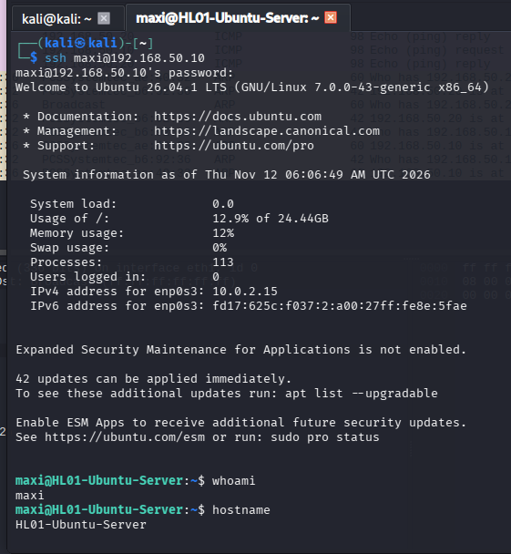

Figura 13. Sesión remota y comprobación de identidad local. La bienvenida muestra Ubuntu 26.04.1 LTS.

Para reproducir la verificación de huella no elimino known_hosts solamente para forzar otra advertencia. Si la identidad cambió, investigo antes de aceptar el cambio. El documento 03 explica la relación entre host keys, known_hosts y claves de usuario.

## 9. Sesiones, registros y observación de TCP

### Correlación entre sistema y red

```bash
# Ubuntu, con una sesión SSH abierta
sudo ss -ntp state established
systemctl status ssh.service --no-pager
sudo journalctl -u ssh.service -b -n 30 --no-pager
```

Identifiqué una conexión de 192.168.50.20:50332 hacia 192.168.50.10:22. En el registro encontré Accepted password for maxi desde ese mismo origen y puerto. También aparecían un tiempo de autenticación agotado y un intento rechazado. No presenté esos fallos aislados como prueba de ataque.

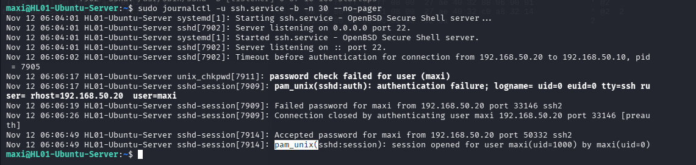

Figura 14. Registros de SSH: resultado de autenticación, cuenta, dirección y puerto permiten correlacionar la sesión.

Salí con exit y consulté el registro y las conexiones establecidas. Cerrar una sesión no implica detener el servidor ni retirar el socket de escucha.

```bash
# En la sesión que voy a cerrar
exit
# En la consola de Ubuntu o en otra sesión de administración
sudo journalctl -u ssh.service -b -n 15 --no-pager
sudo ss -ntp state established
```

### Captura del establecimiento y cierre

En Kali inicié una captura en eth1 antes de abrir una nueva sesión y utilicé tcp.port == 22. El PDF conserva un establecimiento con puerto cliente 41500. El PCAP 04 conserva otro intercambio con puerto 33648. Los mantengo separados de la sesión 50332 del registro.

| Evidencia | Puerto cliente | Uso en el informe |
| --- | --- | --- |
| Salida ss y registro de autenticación | 50332 | Correlación de cuenta y socket |
| Capturas de SYN y SYN/ACK del PDF | 41500 | Lectura de cabeceras TCP |
| 04-ssh-conexion-y-cierre.pcapng | 33648 | Recorrido verificable de apertura y cierre |

En el archivo 04 hay 778 tramas TCP. Las primeras tres corresponden a SYN, SYN/ACK y ACK. Después aparecen identificación y negociación SSH; el contenido posterior de la sesión está protegido. No puedo recuperar los comandos ejecutados dentro de SSH mirando solamente esta captura cifrada.

| Trama del archivo 04 | Sentido | Flags | Qué compruebo |
| --- | --- | --- | --- |
| 1 | Kali → Ubuntu | SYN | Inicio de sincronización |
| 2 | Ubuntu → Kali | SYN, ACK | Respuesta y confirmación del SYN |
| 3 | Kali → Ubuntu | ACK | Confirmación del SYN del servidor |
| 775 | Kali → Ubuntu | FIN, ACK | Kali termina su envío |
| 776 | Ubuntu → Kali | ACK | Ubuntu confirma ese FIN |
| 777 | Ubuntu → Kali | FIN, ACK | Ubuntu termina su envío |
| 778 | Kali → Ubuntu | ACK | Kali confirma el FIN de Ubuntu |

El FIN de Kali tiene Seq relativo 16978 y se confirma con Ack 16979. El FIN consume una posición de secuencia aunque no transporte datos. La tabla completa evita confundir el filtro de FIN con la totalidad del cierre. [R5]

```bash
tcp.port == 22 && tcp.port == 33648
tcp.port == 22 && (tcp.flags.fin == 1 || tcp.flags.reset == 1)
```

El segundo filtro oculta ACK que no tengan FIN o RST. No lo uso para afirmar que no existió una confirmación final. Los puertos y números de trama son referencias de estos archivos, no valores que deban repetirse en otra ejecución.

## 10. Usuarios, grupos y permisos

Con la sesión en Ubuntu inspeccioné mi identidad, directorios y archivos de claves del servidor. Consulté metadatos; no mostré el contenido de la clave privada.

```bash
id
ls -ld /home/maxi /etc/ssh
ls -l /etc/ssh/ssh_host_ed25519_key \
  /etc/ssh/ssh_host_ed25519_key.pub
```

Observé uid=1000 para maxi y pertenencia al grupo sudo. Eso no me convierte permanentemente en root: sudo eleva privilegios según la política cuando lo invoco. Para probar permisos trabajé sin sudo, porque una operación privilegiada puede eludir restricciones que quiero observar.

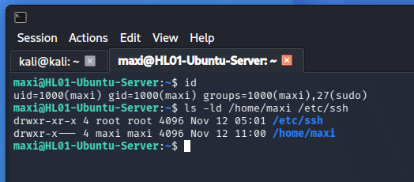

Figura 15. Identidad de la cuenta y permisos de directorios. El propietario de /etc/ssh es root; el de /home/maxi es maxi.

```bash
mkdir -p ~/homelab01/permisos
touch ~/homelab01/permisos/nota.txt
ls -l ~/homelab01/permisos/nota.txt
chmod go-rw ~/homelab01/permisos/nota.txt
chmod u-w ~/homelab01/permisos/nota.txt
echo "Prueba de permisos" >> ~/homelab01/permisos/nota.txt
chmod u+w ~/homelab01/permisos/nota.txt
```

El archivo de práctica inicialmente tenía -rw-rw-r--. Al quitar lectura y escritura a grupo y otros quedó -rw-------; al retirar la escritura del propietario la redirección falló. Restauré u+w y comprobé nuevamente la escritura. Esto es un caso sencillo de mínimo privilegio aplicado al archivo, no una auditoría completa de permisos del sistema.

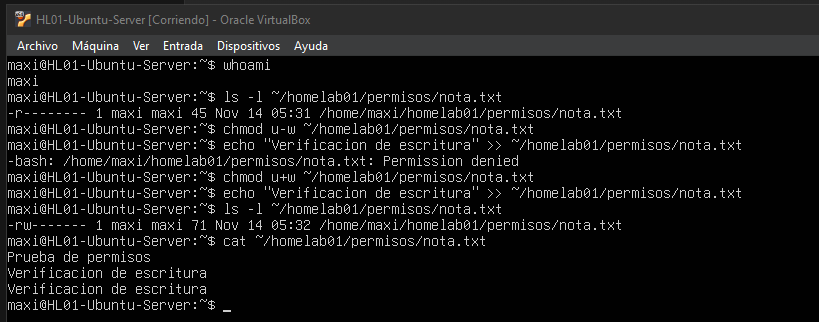

Figura 16. Verificación posterior aportada para esta edición. Empieza con el archivo sin escritura, muestra Permission denied, restaura u+w y termina con -rw------- y contenido legible.

En esa verificación el archivo pasó de 45 a 71 bytes después de una escritura exitosa. La línea repetida que muestra cat corresponde a pruebas acumuladas; no borré el archivo para producir una salida artificial. La existencia de contenido previo no altera la conclusión sobre el permiso.

## 11. UFW y comprobación final

Preparé el firewall de Ubuntu conservando acceso a su consola de VirtualBox. Primero revisé el estado y las reglas guardadas, antes de activar el filtrado.

```bash
# Ubuntu
sudo ufw status verbose
sudo ufw show added
ip -br address
sudo ufw default deny incoming
sudo ufw default allow outgoing
sudo ufw allow in on enp0s8 proto tcp \
  from 192.168.50.20 to 192.168.50.10 port 22
sudo ufw show added
sudo ufw enable
```

Corregí el error de transcripción outcoming por outgoing. La regla permite entrada en Ubuntu por enp0s8 desde Kali a la IPv4 interna de Ubuntu y TCP 22. Es tráfico saliente desde la perspectiva de Kali, pero la regla se administra como entrada en Ubuntu. [R6]

Abrí otra terminal en Kali y comprobé una conexión SSH nueva, manteniendo la anterior durante la validación. Una sesión que ya estaba establecida no basta para demostrar que las reglas permiten nuevas conexiones.

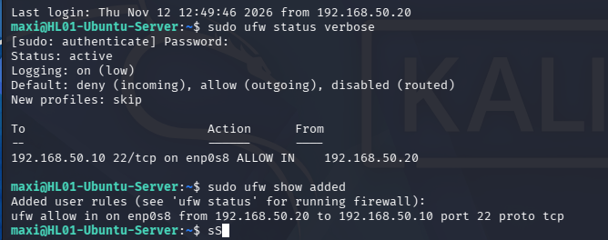

Figura 17. UFW activo, políticas predeterminadas y regla específica para SSH. show added consulta reglas de usuario guardadas; status informa el estado activo.

No afirmo que esta configuración bloquee absolutamente todo paquete distinto de SSH. UFW incluye reglas previas, tratamiento de conexiones establecidas y comportamiento específico para otros protocolos, incluido ICMP. La regla por IP tampoco autentica criptográficamente a Kali ni reemplaza la autenticación de SSH.

### Arranque y criterios de cierre

Cerré sesiones con exit, apagué las VM con sudo poweroff y las volví a iniciar. Confirmé que la comunicación y la configuración persistían. Los comandos de comprobación final que reúne esta guía son:

```bash
# Kali
ip -br address
ip route get 192.168.50.10
ssh maxi@192.168.50.10
```

```bash
# Ubuntu
ip -br address
sudo ufw status verbose
sudo ufw show added
```

| Criterio | Resultado documentado |
| --- | --- |
| IPv4 internas y selección de ruta | Funcionamiento confirmado con la configuración persistente |
| ARP e ICMP local y externo | Capturas y PCAP disponibles |
| SSH y registros | Acceso con contraseña, observación de socket y autenticación |
| Establecimiento y cierre TCP | Verificados en el archivo 04 |
| Permisos | Rechazo sin escritura y éxito al restaurarla |
| UFW y nueva sesión | Regla aplicada y acceso permitido verificado |
| Persistencia tras apagado | Confirmada al cierre; no dispongo de una imagen de cada consulta posterior |

## 12. Dificultades, conclusiones y límites

| Situación | Cómo razoné y comprobé | Qué evité concluir |
| --- | --- | --- |
| Kali enviaba al gateway para llegar a Ubuntu | Consulté la ruta, la IP activa y el perfil; guardé y activé la configuración interna | No agregué una ruta manual para ocultar una IP que faltaba. |
| Netplan no mostraba la IP activa | Comparé el archivo guardado con el estado del kernel y añadí la interfaz interna | Que un ping funcionara no probaba persistencia. |
| No aparecía tráfico esperado en Wireshark | La pauta reproducible es comprobar interfaz, captura iniciada y filtro; después generar tráfico nuevo | No atribuí automáticamente la ausencia a un fallo de red. No reconstruyo una causa histórica no conservada. |
| ARP sin respuesta | Identifiqué las solicitudes y el vecino FAILED | No supuse rechazo del ping por el destino. |
| ssh.service inactivo antes de conectar | Revisé ssh.socket y la escucha | Inactivo no equivalía a puerto cerrado en esta configuración. |
| El filtro de cierre mostraba solo FIN | Amplié a toda la conversación; el PCAP conserva los ACK | Dos filas filtradas no representaban todo el cierre. |
| Escritura rechazada | Revisé propietario y bits; restauré escritura al propietario | No usé sudo como solución automática a un permiso quitado deliberadamente. |

Aprendí a relacionar una decisión de ruta con una interfaz, un siguiente salto, una MAC y una trama. También conecté un servicio de acceso remoto con un socket, una cuenta autenticada, procesos y registros. Pude aplicar una regla de entrada sin perder el acceso autorizado y comprobar su conservación tras el arranque.

Mis límites son concretos: no conservé toda la instalación inicial ni una transcripción íntegra del chat; varias sesiones SSH son distintas; las capturas no permiten leer comandos dentro del canal cifrado; la regla UFW no equivale a un endurecimiento completo del servidor. No comprobé aquí todos los caminos de acceso no autorizados mediante una batería de pruebas negativas.

Como ampliación futura puedo practicar autenticación con claves de usuario, análisis de DNS, permisos de directorios, pruebas negativas de firewall y automatización de inventario. Los mantengo como siguientes ejercicios, no como trabajo completado.

## 13. Evidencias, integridad y referencias

Los números de trama citados corresponden a los archivos recuperados con estos nombres. Renombrar un archivo no cambia sus paquetes, pero exportar una selección puede renumerarlos. Calculo estas huellas durante la revisión documental; no las presento como hashes registrados el día de captura.

| Archivo | Interfaz | Tramas totales | Tráfico principal |
| --- | --- | --- | --- |
| 01-arp-icmp-red-interna.pcapng | eth1 | 15 | 4 ARP y 8 ICMP; 3 tramas adicionales |
| 02-icmp-destino-externo.pcapng | eth0 | 17 | 2 ARP y 8 ICMP; 7 tramas adicionales |
| 03-arp-sin-respuesta.pcapng | eth1 | 3 | 3 solicitudes ARP |
| 04-ssh-conexion-y-cierre.pcapng | eth1 | 778 | Una conversación TCP, cliente 33648 |

SHA-256 del archivo 01

```bash
51913c3cbfe264116fd27f60a29e1d23098b071dad4d1e875d38ed3292bef79a
```

SHA-256 del archivo 02

```bash
d1b4282a9a4d55cfc8d3580848757615993869288882cef28ee866395a6d59aa
```

SHA-256 del archivo 03

```bash
a6758a5eb56694fe8b99eedf8c22706a283819ce9c3fa14c711b8a8a1f0b2da4
```

SHA-256 del archivo 04

```bash
9b0bb4794658fa72f7dbab2fd65deeb21b00d8dd9046c9113afb2b7fd7931aee
```

Las imágenes proceden de mi PDF de trabajo, incluida la verificación posterior de permisos. La topología es un esquema elaborado a partir de la configuración. No incorporé como evidencia capturas de respuestas del chat. Las fechas visibles de los equipos reflejan sus relojes; la hora de envío de una imagen a la conversación no es necesariamente la de ejecución.

Para compartir mantengo direcciones internas y MAC virtuales porque permiten seguir las pruebas. Excluyo contenido de claves privadas, contraseñas y tokens. Los nombres de archivos de claves y sus permisos no revelan su contenido. Una huella de clave pública puede servir para correlacionar un host, pero no es un secreto de autenticación.

### Fuentes técnicas utilizadas para contrastar el funcionamiento

- [R1] NetworkManager, nmcli: https://networkmanager.dev/docs/api/latest/nmcli.html

- [R2] Netplan, generate y try: https://netplan.readthedocs.io/en/stable/netplan-generate/ y https://netplan.readthedocs.io/en/stable/netplan-try/

- [R3] systemd, activación por socket: https://www.freedesktop.org/software/systemd/man/latest/systemd.socket.html

- [R4] OpenSSH, verificación de claves de host: https://man.openbsd.org/ssh y https://man.openbsd.org/ssh-keygen

- [R5] TCP, RFC 9293: https://www.rfc-editor.org/rfc/rfc9293

- [R6] UFW, manual de Ubuntu: https://manpages.ubuntu.com/manpages/noble/man8/ufw.8.html

- ARP, RFC 826: https://www.rfc-editor.org/rfc/rfc826

- ss y journalctl: https://man7.org/linux/man-pages/man8/ss.8.html y https://www.freedesktop.org/software/systemd/man/latest/journalctl.html

Las páginas web describen sus versiones publicadas; para diferencias de opciones consulto también el manual instalado en la VM. Estas fuentes apoyan los conceptos. Mis evidencias locales respaldan los resultados del laboratorio.
